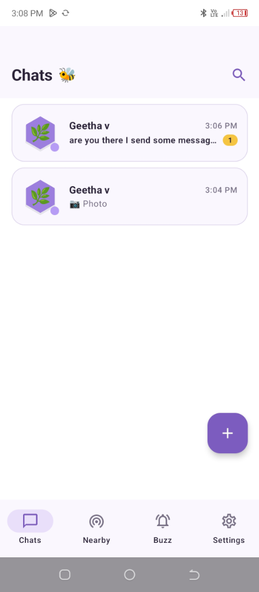
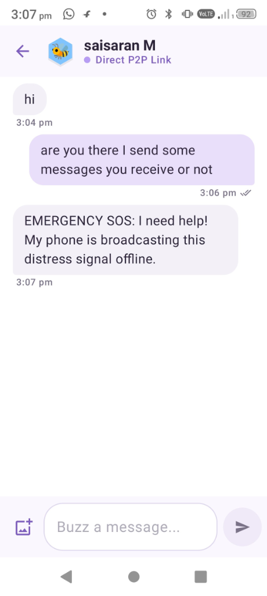
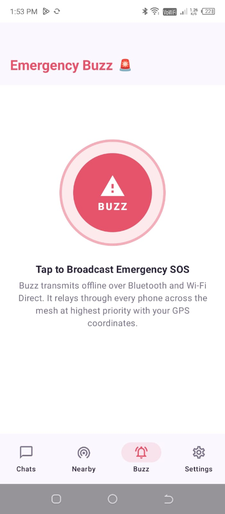
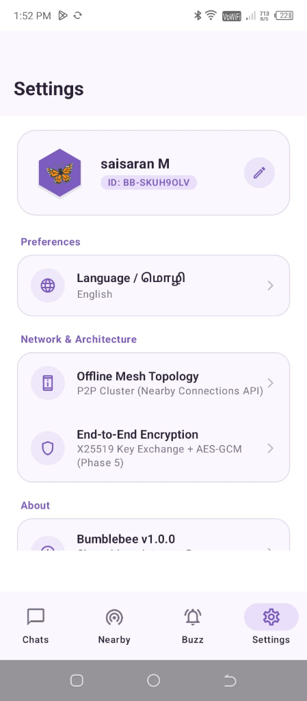

# Bumblebee

Bumblebee is an open-source, 100% offline peer-to-peer (P2P) communication app for Android. It enables smartphones to discover, connect, chat, and share photos directly without an active internet connection, cellular data, or external Wi-Fi routers.

Designed for off-grid scenarios such as natural disasters, remote hiking, flights, crowded events, or regions with poor network infrastructure, Bumblebee turns mobile devices into an ad-hoc local mesh network.

---

## Screenshots

| Chats | Direct P2P Chat | Emergency SOS | Settings & Profile |
| :---: | :---: | :---: | :---: |
|  |  |  |  |

---

## Key Features

- **Zero-Internet Communication**: Connects directly device-to-device using Bluetooth Low Energy (BLE) for discovery and Wi-Fi Direct for high-bandwidth data transfer.
- **Direct Messaging**: One-on-one instant messaging with delivery state tracking (`Sending`, `Sent`, `Delivered`, `Read`).
- **Offline Photo Sharing**: In-chat camera and gallery photo sharing, optimized for fast radio payload transmission with full-screen preview.
- **Honeycomb Discovery Radar**: Real-time visual discovery of nearby devices with 4-digit mutual authentication codes for secure pairing.
- **Emergency SOS Buzz**: Offline emergency distress beacon that broadcasts urgent alerts with coordinates to all peers in range.
- **Privacy by Design**: No cloud servers, no account registration, no telemetry, and no centralized data collection. All chat history and media remain encrypted and stored strictly on the local device.

---

## Technical Architecture

Bumblebee is built following modern Android engineering standards and Clean Architecture principles:

- **Language**: Kotlin 2.1.0
- **UI Toolkit**: Jetpack Compose with Material 3 (Light / Honeycomb palette)
- **Architecture**: MVVM with Unidirectional Data Flow (UDF)
- **Dependency Injection**: Dagger Hilt
- **Local Persistence**: Room SQLite (DAOs, Entities) and Jetpack DataStore Preferences
- **P2P Networking**: Google Play Services Nearby Connections API (`P2P_CLUSTER` strategy)
- **Image Processing**: Android Bitmap compression pipeline & Coil 2.7.0 for async rendering
- **Concurrency**: Kotlin Coroutines & Asynchronous StateFlow / SharedFlow

### Communication Strategy

```
[Phone A]                                               [Phone B]
   |                                                        |
   |--- 1. Bluetooth Low Energy Discovery ----------------->|
   |<-- 2. Mutual Handshake & 4-Digit Authentication ------>|
   |                                                        |
   |<== 3. High-Speed Wi-Fi Direct Data Channel ===========>|
   |       - Text Messages                                  |
   |       - Photo Attachments                              |
   |       - Delivery & Read Acknowledgments                |
```

1. **Discovery Phase**: Bluetooth Low Energy (BLE) continuously advertises and scans for nearby devices within physical range.
2. **Handshake Phase**: Upon connection request, a 4-digit authentication code is verified on both screens to establish a trusted session.
3. **Transmission Phase**: Radio upgrades to Wi-Fi Direct for fast, high-bandwidth communication without going through an external router or access point.

---

## Offline Testing Guide

To test Bumblebee in a fully offline environment:

1. **Install the APK** on two physical Android devices running Android 8.0 (API 26) or higher.
2. **Disconnect from Internet**:
   - Turn **OFF** Mobile Data on both devices.
   - Disconnect from any local Wi-Fi router (the Wi-Fi toggle itself must remain **ON** so Android can operate the Wi-Fi Direct radio).
   - Ensure **Bluetooth** is turned **ON**.
3. **Launch the App**: Complete the initial profile setup (name and avatar).
4. **Grant Permissions**: Allow Bluetooth, Nearby Devices, and Location permissions (required by Android system APIs for P2P discovery).
5. **Connect**:
   - Navigate to the **Nearby (Honeycomb)** tab on both devices.
   - Tap **Scan** on one phone and verify the 4-digit code on the other.
   - Once connected, start exchanging messages and photos directly.

---

## Project Structure

```
app/src/main/java/com/bumblebee/chat/
├── BumblebeeApp.kt               # Application entry point & Hilt setup
├── MainActivity.kt                # Root activity & edge-to-edge host
├── core/
│   ├── constants/                 # App and protocol constants
│   ├── di/                        # Hilt dependency injection modules
│   ├── theme/                     # Material 3 colors, shapes, typography
│   └── utils/                     # DataStore and permission helpers
├── data/
│   ├── local/                     # Room database, entities, and DAOs
│   ├── nearby/                    # Google Nearby Connections manager & packet models
│   └── repository/                # Chat, peer, and preference repositories
├── domain/
│   └── model/                     # Core business entities (Message, Peer, Conversation)
└── ui/
    ├── buzz/                      # Emergency SOS beacon screen & ViewModel
    ├── chat/                      # Direct chat screen, message bubbles, photo viewer
    ├── chats/                     # Conversations list screen & ViewModel
    ├── components/                # Reusable Compose widgets (HexagonAvatar, dialogs)
    ├── navigation/                # Compose Navigation graph & routes
    ├── nearby/                    # Honeycomb radar discovery screen & ViewModel
    ├── onboarding/                # Initial setup screen & ViewModel
    └── settings/                  # App preferences, language, & reset session
```

---

## Building from Source

### Prerequisites

- Android Studio Ladybug (2024.2) or later
- JDK 17 or higher
- Android SDK 35 (Compile SDK)
- Min SDK: Android 8.0 (API level 26)

### Build Commands

Clone the repository and compile using the Gradle wrapper:

```bash
git clone https://github.com/saisaran-m/bumblebee.git
cd bumblebee

# Build debug APK
./gradlew assembleDebug

# Run unit tests
./gradlew testDebugUnitTest
```

The compiled APK will be generated at:
`app/build/outputs/apk/debug/app-debug.apk`

---

## License

This project is licensed under the MIT License. See the [LICENSE](LICENSE) file for details.
